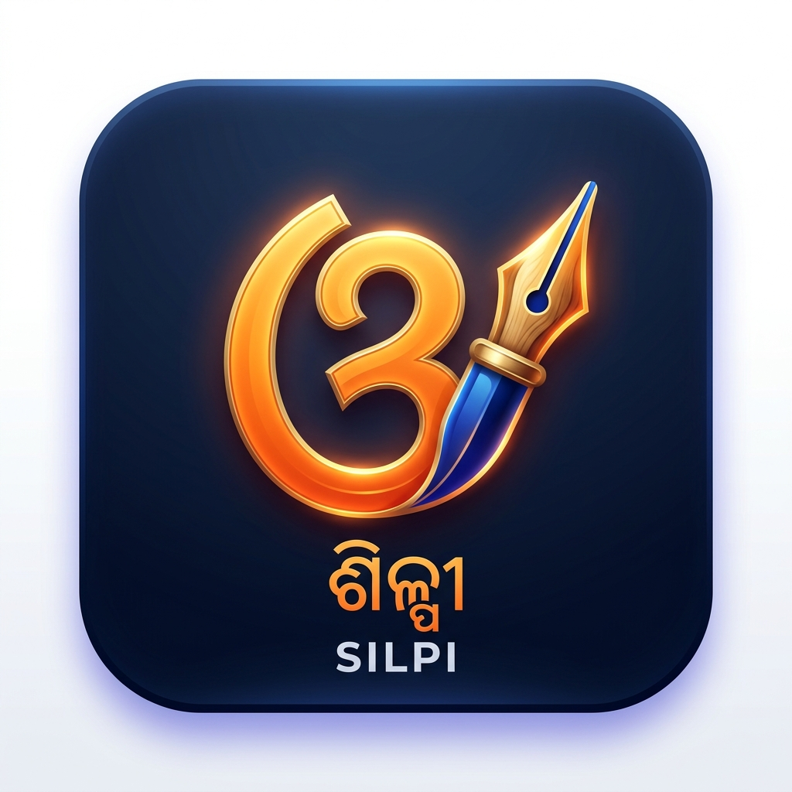

# 🎨 Silpi (ଶିଳ୍ପୀ) – Universal Odia Typing Suite

<p align="center">
  
</p>

<p align="center">
  <b>A modern, standalone, cross-platform Windows Odia typing suite and input method editor.</b><br>
  Works seamlessly across <b>Microsoft Word, Excel, PowerPoint, Notepad, Browsers, and Adobe Creative Cloud</b> on <b>Windows 7, 8, 10, and 11</b>.
</p>

<p align="center">
  <b>Crafted & Engineered with ❤️ by Aniket Nayak</b>
</p>

---

## 🌟 Key Features

1. **Two Powerful Typing Modes**:
   - **Phonetic (Transliteration)**: Type Roman English letters as they sound (`namaskaara` $\rightarrow$ `ନମସ୍କାର`, `bharat` $\rightarrow$ `ଭାରତ`).
   - **Akruti (Classic DTP Touch-Typing)**: Faithful 1:1 mapping of the classic Akruti typewriter layout (`k` $\rightarrow$ `କ`, `a` $\rightarrow$ `ା`, `f` $\rightarrow$ `୍`, `^` $\rightarrow$ `୍ର`, `&` $\rightarrow$ `ର୍`, `Y` $\rightarrow$ `୍ୟ`).
2. **True Yuktakshara (ଯୁକ୍ତାକ୍ଷର) Without Halant Distortion**:
   - Accurately generates conjuncts without leaving stray viramas/halantas (`୍`) at the end of words or breaking ligatures on Windows 10/11.
3. **Floating Word Candidate Box (Autosuggestions)**:
   - Floating, non-activating suggestion bar near your text cursor (`1. ଭାରତ  2. ଭରତ  3. ଭାରତୀ`).
   - Select instantly via number keys `1`–`5` or commit with `Space`/`Enter`.
4. **Interactive On-Screen Keyboard (ଅକ୍ଷର ପଟଳ)**:
   - A floating visual keyboard with non-activating window style (`WS_EX_NOACTIVATE`).
   - Click or touch keys to type directly into active documents without losing window focus.
   - Dedicated quick-access buttons for conjuncts (`କ୍ଷ`, `ଜ୍ଞ`, `ତ୍ର`, `ଶ୍ର`, `୍ର`, `ର୍`, `୍ୟ`, `୍`, etc.).
5. **Legacy Font & Encoding Converter (ଫଣ୍ଟ ରୂପାନ୍ତରଣ)**:
   - Built-in dual-pane utility to convert legacy non-Unicode fonts (*Akruti*, *Sarala*, *AkrutiOriSarala99*, *ShreeLipi*) into modern Odia Unicode for web, email, and social media.
6. **System Tray & Global Hotkeys**:
   - Runs unobtrusively in the background with a system tray menu and customizable global keyboard shortcuts.

---

## 💻 System Requirements

- **Operating System**: Windows 7, Windows 8, Windows 8.1, Windows 10, Windows 11 (32-bit & 64-bit).
- **Runtime**: Python 3.8+ (Uses only standard library modules `ctypes`, `tkinter`, `json`, `queue`, `threading` — **no external dependencies required!**).
- **Applications Supported**: MS Office (2003 through 2024 / Office 365), Notepad, Chrome, Edge, Firefox, Adobe InDesign, Photoshop, WordPad, etc.

---

## 🚀 Quick Start Guide

### 1. Launching Silpi

Simply run the batch launcher:
```bat
Silpi.bat
```
Or launch silently in the background:
```bash
py run_silpi.pyw
```
A golden-saffron chisel icon will appear in your **Windows System Tray** (bottom right near the clock).

---

## ⌨️ Default Keyboard Shortcuts

| Shortcut | Action | Description |
| :--- | :--- | :--- |
| **`Ctrl + Alt + O`** | Toggle Silpi | Enable or disable Odia typing mode. |
| **`Ctrl + Alt + L`** | Switch Language | Toggle quickly between **Odia** and **English** passthrough. |
| **`Ctrl + Alt + K`** | On-Screen Keyboard | Open / hide the visual touch keyboard popup. |
| **`Ctrl + Alt + C`** | Font Converter | Open the Akruti $\rightarrow$ Unicode converter window. |
| **`Ctrl + Alt + S`** | Settings | Open the Settings & Hotkey configuration dialog. |
| **`Ctrl + Alt + Enter`** | Convert Now | Force conversion of the active phonetic buffer. |

---

## 📖 How to Type in Odia

### A. Phonetic Mode (ଫୋନେଟିକ୍ ମୋଡ୍)

Type English Roman words the way they sound in Odia:

- `namaskaara` + `Space` $\rightarrow$ **ନମସ୍କାର**
- `bharat` + `Space` $\rightarrow$ **ଭାରତ**
- `odisha` + `Space` $\rightarrow$ **ଓଡ଼ିଶା**
- `shakti` + `Space` $\rightarrow$ **ଶକ୍ତି**
- `mandira` + `Space` $\rightarrow$ **ମନ୍ଦିର**
- `jagannatha` + `Space` $\rightarrow$ **ଜଗନ୍ନାଥ**
- `dhanyabada` + `Space` $\rightarrow$ **ଧନ୍ୟବାଦ**

#### Word Prediction:
When you start typing, a candidate box floats right under your cursor:
- Press **`Space`** or **`Enter`** to accept candidate **1**.
- Press **`1`**, **`2`**, **`3`**, **`4`**, or **`5`** to pick that specific candidate.
- Press **`Esc`** to cancel suggestions and type plain Roman text.

---

### B. Akruti Mode (ଆକୃତି ମୋଡ୍)

Each keypress corresponds directly to the authentic Akruti DTP layout:

#### Vowels & Matras
| Key | Output | Key | Output |
| :---: | :---: | :---: | :---: |
| `A` | **ଅ** | `a` | **ା** |
| `z` | **ଇ** | `i` | **ି** |
| `Z` | **ଈ** | `I` | **ୀ** |
| `q` | **ଉ** | `u` | **ୁ** |
| `Q` | **ଊ** | `U` | **ୂ** |
| `w` | **ଏ** | `e` | **େ** |
| `W` | **ଐ** | `E` | **ୈ** |
| `` ` `` | **ଓ** | `o` | **ୋ** |
| `~` | **ଔ** | `O` | **ୌ** |

#### Consonants
| Key | Output | Key | Output | Key | Output |
| :---: | :---: | :---: | :---: | :---: | :---: |
| `k` | **କ** | `K` | **ଖ** | `g` | **ଗ** |
| `G` | **ଘ** | `*` | **ଙ** | `c` | **ଚ** |
| `C` | **ଛ** | `j` | **ଜ** | `J` | **ଝ** |
| `_` | **ଞ** | `'` | **ଟ** | `"` | **ଠ** |
| `[` | **ଡ** | `{` | **ଢ** | `N` | **ଣ** |
| `t` | **ତ** | `T` | **ଥ** | `d` | **ଦ** |
| `D` | **ଧ** | `n` | **ନ** | `p` | **ପ** |
| `P` | **ଫ** | `b` / `v` | **ବ** | `B` | **ଭ** |
| `m` | **ମ** | `F` | **ଯ** | `y` | **ୟ** |
| `r` | **ର** | `l` | **ଲ** | `L` | **ଳ** |
| `s` | **ସ** | `S` | **ଶ** | `H` | **ଷ** |
| `h` | **ହ** | `V` | **ଡ଼** | `M` | **ଢ଼** |

#### Forming Yuktakshara (Conjuncts) in Akruti Mode
- **Manual Halanta Linking**: Press `f` (`୍`) between consonants:
  - `k` + `f` + `t` $\rightarrow$ **କ୍ତ**
  - `s` + `f` + `k` $\rightarrow$ **ସ୍କ**
  - `n` + `f` + `d` $\rightarrow$ **ନ୍ଦ**
- **Single-Key Conjunct Shortcuts**:
  - `^` $\rightarrow$ **୍ର** (Ra-phala)
  - `&` $\rightarrow$ **ର୍** (Reph)
  - `Y` $\rightarrow$ **୍ୟ** (Ya-phala)
  - `#` $\rightarrow$ **କ୍ଷ**
  - `$` $\rightarrow$ **ତ୍ର**
  - `%` $\rightarrow$ **ଜ୍ଞ**
  - `@` $\rightarrow$ **ଶ୍ର**

---

### C. Using the Legacy Font Converter

1. Press **`Ctrl + Alt + C`** or right-click the Silpi tray icon $\rightarrow$ **Font Converter (ଫଣ୍ଟ ରୂପାନ୍ତରଣ)...**
2. Paste non-Unicode text typed in legacy Akruti or Sarala fonts into the left pane.
3. Click **"⚡ Convert to Unicode"**.
4. Click **"Copy Unicode Output"** and paste anywhere on the web, email, or modern MS Word documents!

---

## 🛠️ Project Structure

```
Silpi/
├── Silpi.bat                 # 1-click batch launcher
├── run_silpi.pyw             # Background entry point (no terminal window)
├── README.md                 # Complete user guide and documentation
└── silpi/
    ├── __init__.py           # Package initialization
    ├── __main__.py           # Command-line entry (py -m silpi)
    ├── app.py                # Main application lifecycle & tray menu
    ├── win32util.py          # Low-level Win32 keyboard hook & SendInput engine
    ├── ime.py                # Core input method editor logic & dispatch
    ├── translit.py           # Odia phonetic transliteration parser
    ├── candidates.py         # Word prediction & dictionary ranking
    ├── candidate_ui.py       # Floating non-activating candidate popup
    ├── akruti_layout.py      # Canonical Akruti layout KEYMAP
    ├── akruti_map.py         # Legacy font ASCII to Unicode reordering engine
    ├── keyboard_ui.py        # Interactive On-Screen visual keyboard
    ├── converter_ui.py       # Dual-pane legacy font converter GUI
    ├── settings_ui.py        # Settings dialog & hotkey recorder
    ├── config.py             # Configuration persistence (%APPDATA%\Silpi\config.json)
    └── assets/
        ├── silpi.ico         # App & tray icon
        └── silpi.png         # High-resolution logo
```

---

## 👤 Author & Credits

- **Creator & Lead Developer**: **Aniket Nayak** ([@sikunaniket1234](https://github.com/sikunaniket1234))
- **Layout & Converter Data**: Reverse-engineered and verified against open-source Odia orthography datasets and Wikimedia resources (`OdiaWikimedia/Kunji-Binyasa` and `OdiaWikimedia/Converter`).

---

## 📄 License

Open-source under the [MIT License](LICENSE). Free for personal, educational, and commercial publishing use.
